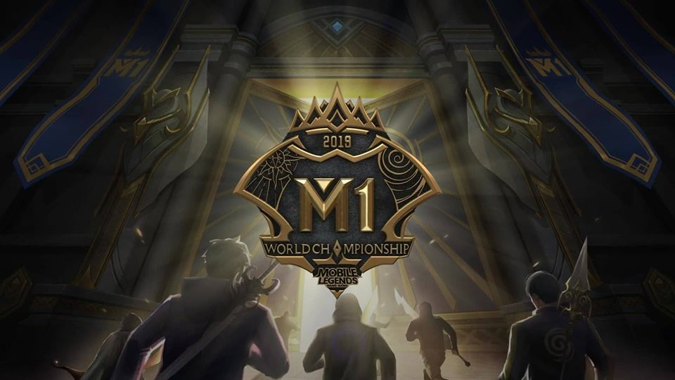
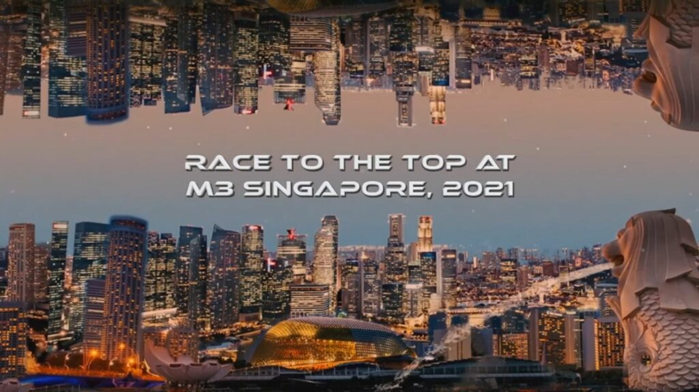
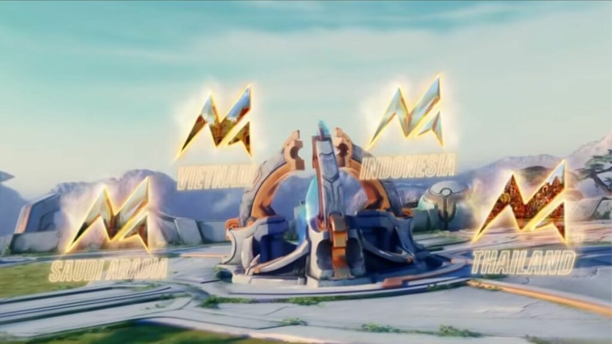

# Master Timeline — Mobile Legends: Bang Bang (2016–2026)

A single chronological spine for the database. Each entry is sourced in the corresponding CSV (see the `sources` column there). Images are stored locally; rows with no trusted art carry no embed. Sub-sections mirror the era structure of `meta_history.md`.

## 2016 — Origin

| Date | Event | Type |
|---|---|---|
| 2016-07-14 | Global Android release (≈10 heroes; "Mobile Legends: 5v5 MOBA") | Launch |
| 2016-07 → 12 | Launch roster grows to ~30 heroes (Miya…Argus-era) | Heroes |
| 2016 (year) | Original emblem system, original map (Land of Dawn), Fury/Interference/Stun spell kit | Systems |
| 2016-11-09 | Global iOS release | Launch |

## 2017 — Name change and first structure

| Date | Event | Type |
|---|---|---|
| 2017 | Riot Games lawsuit → game renamed "Mobile Legends: Bang Bang"; settled (also 2024 global settlement recorded) | Business |
| 2017-09-15 | Patch 1.2.16 — first landmark hero rework (Akai); only day-precise date of the 2016–19 patch archive | Patch |
| 2017 | Patch 1.2.14 — Turtle/Lord/jungle/brush rework; 1.2.22 Lancelot release; 1.2.46 Retribution 30s→35s | Patch |
| 2017-09 | MSC 2017, Jakarta — first MSC, won by IDONOTSLEEP (TH) | Esports |

## 2018 — The pro circuit forms

| Date | Event | Type |
|---|---|---|
| 2018-07-27/29 | MSC 2018 (Jakarta) — Aether Main (PH) champions | Esports |
| 2018 | MPL Philippines & MPL Indonesia inaugural seasons | Esports |
| 2018-11 | 70-hero roster milestone (Wikipedia-verified) | Heroes |
| 2018-19 | Celestial Palace map era begins (1.3.36 revamp) | Systems |

## 2019 — Project NEXT announced

| Date | Event | Type |
|---|---|---|
| 2019 | Bruno revamp (1.3.96/1.3.98 Adv); assassin rework wave teased (Natalia/Hanzo/Lancelot) | Patch |
| 2019-05-07 | High Frame Rate mode rolls out (Snapdragon 710 devices first) | Client |
| 2019-07-18 | **MLBB 2.0 client**: Unity engine 4→2017, Imperial Sanctuary map, new UI | Client |
| 2019-08-09 | X.Borg release | Heroes |
| 2019-11-10/17 | **M1 World Championship, Kuala Lumpur** — EVOS Legends champion, FMVP Oura, $250K, 648,069 peak viewers | Esports |
| 2019-11 | King of Fighters collab wave 1 begins the crossover era | Collab |
| 2019-12 | Project NEXT announced (revamp program) | Client |

## 2020 — Pandemic boom, NEXT phase 1

| Date | Event | Type |
|---|---|---|
| 2020-03-20 | Atlas release | Heroes |
| 2020-06-19 | Yu Zhong release (1.4.86) | Heroes |
| 2020-09-22 | Project NEXT phase (revamps + tutorial) | Client |
| 2020-10-30 | **100th hero: Benedetta** | Heroes |
| 2020-10 | 1 billion downloads milestone | Business |

## 2021 — M2/M3 and the 1.5.88 equipment reset

| Date | Event | Type |
|---|---|---|
| 2021-01-18/24 | **M2, Singapore** — Bren Esports champion, FMVP KarlTzy, $300K, 3.08M peak | Esports |
| 2021-03-22 | **ByteDance acquires Moonton (~$4B reported)** | Business |
| 2021 (mid) | **1.5.88**: legacy jungle + roam equipment removed; roaming footwear + blessings; War Axe, Shadow Twinblades, Radiant Armor added | Systems |
| 2021-05-05 | Star Wars collab teaser (region-locked, 12 markets) | Collab |
| 2021-12-06/19 | **M3, Singapore** — Blacklist International champion, FMVP Oheb, $800K, 3.19M peak; utility meta canonized | Esports |

## 2022 — Sanctum Island and esports reset

| Date | Event | Type |
|---|---|---|
| 2022-01 | Sanctum Island map live (announced with 1.6.42, 2021-12-30) | Systems |
| 2022-02 | Sanrio/Hello Kitty collab (reruns 2025/2026) | Collab |
| 2022-04-21/22 | MPL ID S9 EVOS–Alter Ego disconnect incident + 4-minute pause (sourced bug/rulings example) | Esports |
| 2022-08-20 | Kung Fu Panda collab | Collab |
| 2022-10-21 | Saint Seiya collab (full draw mechanics documented) | Collab |
| 2022-12-20 | **1.7.44: emblem revamp live** — 7 sets, Standard 16 + Core 8 talents; Swift Crossbow added | Systems |

## 2023 — Filipino golden age completes

| Date | Event | Type |
|---|---|---|
| 2023-01-01/15 | **M4, Bali** — ECHO champion, FMVP Bennyqt, $800K, 4.27M peak | Esports |
| 2023-03-25 | Season 28: star system replaces Mythic Points; Mythical Honor tier | Systems |
| 2023-06-27 | Season 29: Mythical Immortal added | Systems |
| 2023-02-18 | Jujutsu Kaisen collab (2024 second wave) | Collab |
| 2023 | Starlium Scythe + Malefic Gun ("NEXT" items) | Items |
| 2023-11-23/12-17 | **M5, Manila** — AP Bren champion, FMVP FlapTzy, $900K, 5.07M peak (then-record) | Esports |
| 2023 | MPL Indonesia S4 franchise era documented: $1M fee + $8M ecosystem pledge | Business |

## 2024 — EWC era and 10 bans

| Date | Event | Type |
|---|---|---|
| 2024-01 | 10-ban (5/side) Mythic+ draft (~Jan 2024, flagged) | Systems |
| 2024-02-02 | Attack on Titan collab | Collab |
| 2024-04-24 | KOF collab wave 3 | Collab |
| 2024-06-19 | **Project NEXT 2024 map revamp**; Sky Piercer released | Systems/Items |
| 2024-06/07 | Esports World Cup 2024, Riyadh — MSC@EWC begins (SRG champion; patch 1.8.92) | Esports |
| 2024-11-21/12-15 | **M6, Kuala Lumpur** — Fnatic ONIC Philippines champion, FMVP Kelra, $1M, 4.02M peak | Esports |

## 2025 — The 2.x scheme, Naruto, and the US episode

| Date | Event | Type |
|---|---|---|
| 2025-01-19/20 | US "PAFACA" enforcement episode hits availability; return by Jan 24; Skystone US publishing handover (Mar 26–27) | Business |
| 2025-02/03 | **Savvy Games Group acquisition of Moonton reported** (Reuters 2026-02-13/03-20 chain — see business.csv for the verified date set) | Business |
| 2025-04-21 | Naruto Shippuden collab announced; phase 1 live 2025-05-02 (free Gaara-Vale) | Collab |
| 2025-06-18 | Patch 1.9.90 | Patch |
| 2025-06-17 | **Hirara — 133rd hero** (official 2.1.88 notes + Wikipedia) | Heroes |
| 2025-06-21 | Zetian release + official Academy Advanced Guide event | Heroes/Academy |
| 2025 (late) | **Version scheme jumps 1.9.99 → 2.1.02** (no 1.10.x/2.0.x) | Client |
| 2025-11 | SpongeBob collab (single-source, flagged) | Collab |
| 2025-12-25 | **Patch 2.1.40** (official notes mined in full: Zhuxin, roam/jungle chains, Vengeance reflect 35→25%) | Patch |

## 2026 — Tenth anniversary and the 5.68M record

| Date | Event | Type |
|---|---|---|
| 2026-01-03/25 | **M7, Jakarta** — Aurora Gaming PH 4–0 Alter Ego, FMVP Light, $1M, **5,680,511 peak (all-time mobile esports record)** | Esports |
| 2026-01-25 | **M8 announced: Türkiye, January 2027** (Thailand wildcard) | Esports |
| 2026-02/03 | Savvy Games Group acquisition confirmed across Reuters/Bloomberg/GamesBeat/SCMP/GI.biz | Business |
| 2026-03-27 / 04-27 | Naruto phase 2 and final-arc phases | Collab |
| 2026-06-17 | Patch 2.1.88 (Highlights + Match Replays; roam/jungle rework chains) | Patch |
| 2026-06-28 | 120 FPS verified on current devices | Client |
| 2026-07 | MSC@EWC 2026 moves to Paris; Team Spirit champion 4–3 Yangon Galacticos (2.88M peak) | Esports |
| 2026-08-13 | Chaos Clash Phase II | Modes |
| 2026-09-04/10-16 | 10th anniversary "ALL IN" campaign across 10 countries; Season 42 "Starward Decade" | Client/Events |
| 2026-09-16 | **Patch 2.2.16** (current; hotfix 2.2.16a on 2026-10-14) | Patch |
| 2026-09-28 | **2026 Annual Map Change**: Revealing Wisps, Golden Turrets, Healing Turtle, icy Lord | Systems |
| 2026-12-16 | Ranked Season 42 ends (scheduled) | Systems |

## Cross-links

- Patch rows → `patch_index.csv` (85 versions with sources)
- Hero rows → `hero_changes.csv` (350 rows) and `hero_master.csv` (133 heroes with portraits)
- M-Series rows → `mseries.csv` (full field set incl. viewership + FMVP chain)
- Esports rows → `esports.csv` (MPL/MDL/MSC/EWC/MWI/SEA Games/Asian Games/IESF)
- Systems rows → `systems.csv` (map lineage, objectives, modes, ranking, draft, emblems, spells)
- Client/collab rows → `client.csv` (18 collab waves, UI milestones, credit score)
- Business rows → `business.csv` (Moonton, ByteDance, Savvy, monetization, awards)

  
